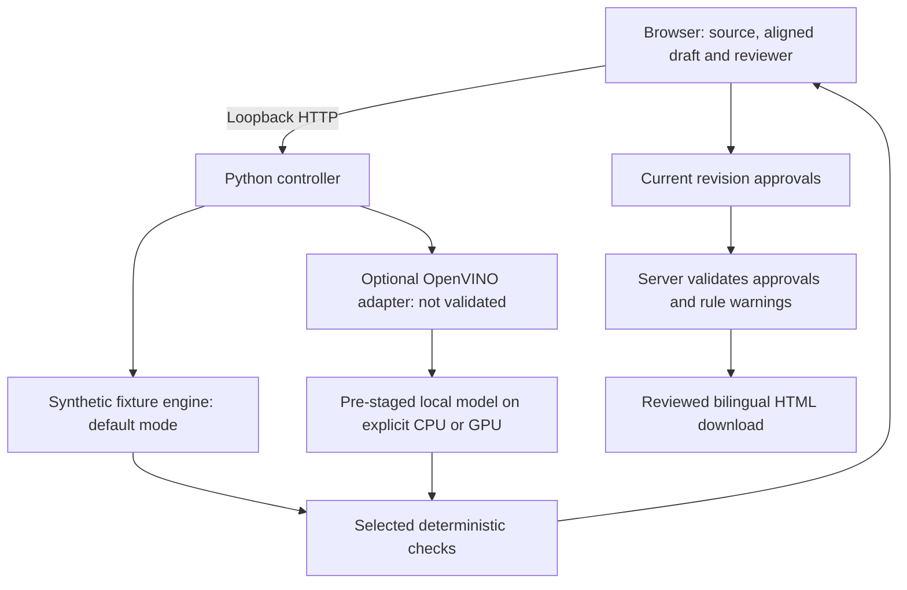
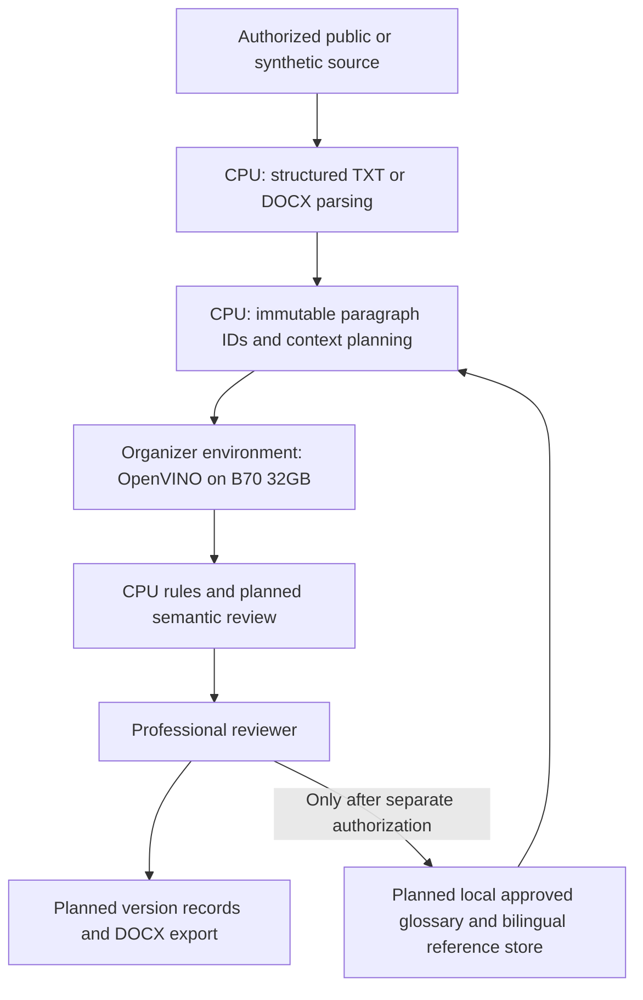

# TENET system architecture

## Current prototype

The server has no cloud inference route. Requested model failures stop execution. No model weights, production documents or case database are bundled. No persistent audit record or identity authentication is implemented.

## Planned competition deployment

Organizer SDV is a hosted validation environment. It does not establish office-local data residency. A future office deployment must stage model assets, verify offline operation and test storage and egress controls separately.
